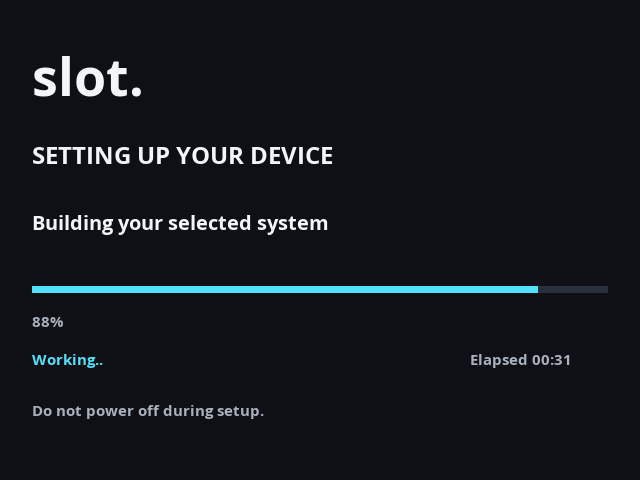

# Installation, storage and recovery

## Before starting: stock Android and the legacy bootloader

**If your RG353V still has Android, first follow the original [ROCKNIX RG353V installation instructions](https://rocknix.org/devices/anbernic/rg353pmvvs/#installation) and get ROCKNIX booting successfully on the device. Then return here to flash and install Slot.** Confirming ROCKNIX boots from SD is sufficient; you do not need to install ROCKNIX onto eMMC first.

The upstream guide covers the incompatible legacy bootloader and Android removal. That preparation erases internal Android/data; back up first and follow the device-specific instructions directly. Do not repeat it on an already working compatible Linux installation. ROCKNIX's separate [generic internal installer](https://rocknix.org/play/installtointernal/) is for listed Qualcomm platforms, not the RG353V/RK3566.

Our installer starts only after the Slot TF1 starter boots. Current clean-install qualification began with a compatible internal Linux boot chain; direct conversion from stock Android has not been separately qualified.

### Included eMMC bootloader and F-held recovery

The release image includes our validated RG353V U-Boot loader. Choosing **Install to internal storage** installs that loader onto eMMC after the system files have been verified, then reads the written loader back and checks its checksum. This replaces the previous writable internal bootloader.

- **Normal Power-on:** try Slot on eMMC first, with no boot-menu countdown.
- **Hold F before Power-on:** try the bootable TF1 SD first; keep F held until its splash/setup appears.
- If the preferred boot flow returns without booting, the loader tries the other medium.

Choosing **Set up this SD card** does not replace the internal bootloader. The F shortcut requires our loader to have been installed on eMMC; it is not assumed on factory firmware. Loader selection avoids an intentional boot delay, but storage and system startup still take time; the timings below start at Linux entry.

## Choose a destination

After the boot prerequisites above are satisfied, the starter image runs from a microSD in TF1. Setup can expand that same SD or install the complete system to internal eMMC. The RG353V's eMMC is approximately 32 GB nominal; use the capacity displayed by setup, not a card's advertised size. **Installing to eMMC replaces its existing system and Android.** Back up first.

For startup performance, the current system reaches the shelf in **about 4.2–4.3 s when booted from eMMC**, versus **about 5.2 s from the tested TF1 microSD**. SD time depends on the card's speed and quality. These are Linux-entry-to-shelf measurements; the Power/rumble and bootloader interval is separate. See the [controlled comparison](Boot-and-Recovery.md#latest-controlled-restarts).

New SD and eMMC installations use this layout:

| Partition | Size | Purpose |
| --- | --- | --- |
| Boot | 512 MiB | Kernel, compressed system payload and managed boot/update files |
| Linux storage | 512 MiB | Persistent OS settings, service configuration and managed runtime data |
| SLOT | Remaining usable space, exFAT | Games, saves, states, labels, wallpapers and screenshots |

The small compressed starter image is not the final partition size. Setup uses the selected disk's actual sector count and assigns the remaining capacity to SLOT. The compressed size also differs from the raw image's logical size.

This returns **5 GiB** to SLOT compared with the earlier layout. The loader reserve and partition-table space are separate. Existing installations retain their original layout: an OTA update does not shrink partitions or move your games. Changing an existing layout requires a backup and a fresh installation.

The 512 MiB Linux partition includes room for feature selection and OTA staging, not just the installed settings. Setup builds one unpacked system tree and compresses directly to a pending file on the boot partition. It removes the unpacked build tree, independently extracts and checks the compressed result, then replaces the original boot `SYSTEM`. A journal records ownership of incomplete output so an interrupted install can retry safely.

Disposable Linux filesystem tests of the current full-feature payload peaked at approximately **329 MiB** on Linux storage, leaving approximately **143 MiB available**. This includes the complete installer boot backup, feature packages and assembly/verification workspace. The equivalent system-output workflow peaked at approximately 396 MiB. The earlier 386 MiB estimate omitted roughly 10 MiB of loader/setup files from its modeled backup; the current comparison includes those files. Historical development captures and build workspaces belong on the development computer, outside this installation budget.

Delta updates reduce downloads; they still need room to reconstruct and verify changed OS files. Boot storage retains compressed rollback and trial payloads alongside the current payload. The current three-payload staging test used approximately **270 MiB** of boot storage. The updater checks available space before staging and refuses an update that cannot fit. These measurements qualify the current payload; larger future payloads need the same space checks and qualification.

## Flash and set up

### 1. Flash the starter image

1. Back up `Games`, `Saves`, `States`, `Labels`, `Wallpapers`, `Screenshots`, `BIOS` and `Config` from an existing installation.
2. Select this project's public `.img.gz` in balenaEtcher. You can select the compressed file directly.
3. Select the **temporary/removable microSD**, checking its capacity. Flashing erases that card. Do not select a computer's internal disk.
4. Flash, wait for completion and safely eject the card. Insert it in the RG353V's **TF1** slot while the handheld is off.
5. Start the handheld. If our eMMC bootloader is already installed, hold **F before pressing Power** and keep F held until setup appears. This F shortcut belongs to our loader; factory firmware may behave differently.

On a macOS file-open dialog, **Command + Shift + G** opens Go to Folder if you need to paste the downloaded image's path. Windows and Linux can select the downloaded file normally.

### 2. Choose where to install

**Set up this SD card** keeps Slot on the card you just flashed and allocates its remaining space for games. This keeps an already compatible internal Linux installation intact. Stock Android still has the prerequisite described above.

**Install to internal storage** copies the complete selected system to eMMC and replaces its existing contents, including Android. The SD is the installer source. The capacities shown here are examples; trust the values on your own device.

Use **Up/Down** to choose and **A** to continue. B powers off from this first page.

### 3. Pick a preset

| Preset | What happens next |
| --- | --- |
| Minimal | mGBA for all three consoles, with the essential runtime. Goes straight to review. |
| Recommended | Adds USB Storage, TF1/TF2 games, shaders, overlays and rewind. Goes straight to review. |
| Full | Installs every emulator and feature available in this image, including networking and development tools. Goes straight to review. |
| Custom | Opens the feature selector. You choose the installed emulators and optional modules. |

Use the **D-pad in all four directions** to move through the 2×2 grid: Minimal / Recommended on top, Full / Custom below. Press **A** to select or **B** to return. Full automatically follows the image's module catalog; future features are included without maintaining a separate preset list. It installs optional capabilities; settings such as Enhanced Audio remain Off until enabled.

Minimal and Recommended do not install networking or developer tools. A Minimal SD installation can receive games through a computer card reader. Before choosing Minimal for internal storage, consider how you will add games; choose Recommended, Full or Custom to include a transfer method.

### 4. Select features, if using Custom

Use **A or Left/Right** to turn a feature On/Off. Hold Up/Down to move through the longer list. **Y** explains the selected feature; **B** closes the explanation.

At least one emulator is required. mGBA plays GB/GBC/GBA; gpSP plays GBA. The selector adds required dependencies where appropriate and explains unavailable combinations. [Every module and its explanation](Setup-and-Modules.md).

Choose **Review Installation** at the bottom. B returns to presets.

Read access warnings carefully. An eMMC installation without USB Storage, an external-card route or a network service has no convenient way to receive games afterward. Go back and select a route if that was unintended.

### 5. Review your selection

Scroll through the entire review to see the destination, consoles, preset, installed features, game-transfer routes and startup behavior. This page does not change toggles. **B** goes back to edit; **A** advances to confirmation.

### 6. Confirm the destination

| SD setup | Internal installation |
| --- | --- |
|  |  |

The final page shows the partition allocation. The initial choice is **Cancel**. Select **Set Up SD Card** or **Erase and Install** only after checking the destination. Internal installation erases internal data. Use adequate charge or a reliable power source; do not interrupt partitioning or copying.

### 7. Wait for setup

The operation name, progress bar, moving activity indicator and elapsed counter show what is happening. A stage can take longer on a slower card. The illustration is a demonstration, not an installation-speed claim. Do not power off during setup.

### 8. Restart into Slot

Read the completed page for game-folder and transfer instructions; it scrolls. **A** restarts and **B** powers off. With our eMMC selector present, hold **F while pressing A** and retain F until the splash to boot this SD. An eMMC installation starts normally without F.

### 9. Set the clock

Clock setup remains part of first run. Miami/Eastern is preselected. Check the date, time and UTC offset, then press A to confirm. The default is UTC−04:00; use UTC−05:00 during standard time. Do not assume automatic daylight-saving adjustment. Optional automatic network time requires an enabled internet connection. [First-run configuration](First-Run-and-Settings.md).

### Setup animation and video

This rendered walkthrough demonstrates the interface and condenses installation progress. SD capacity, selected modules and installation speed vary.

## Adding games

SLOT contains `Games/GB`, `Games/GBC` and `Games/GBA`. Copy uncompressed files with `.gb`, `.gbc` or `.gba` extensions. ZIP/7z archives are not playable. Add legally obtained BIOS files only where the selected core requires them. The firmware includes no commercial game library or proprietary BIOS.

Use a computer card reader, USB Storage, SMB or SSH according to your installed modules. With external-card support installed, TF1/TF2 can also supply compatible Slot libraries. Do not remove a mounted card: use the storage eject action where available, or shut down first. Never eject the active system disk.

## eMMC boot and recovery

Our installed loader normally starts eMMC. Holding F at power-on selects the recovery/setup SD in TF1. Keep a working recovery card and your backup available when changing kernels or system images. This behavior depends on our installed loader; it is not a universal shortcut of every factory RG353V firmware.

A normal SD boot alongside eMMC may need F on each restart. Test the actual boot disk before changing partitions. Recovery through Rockchip USB loader mode is an advanced route and is not the same as Slot's USB Storage or USB Networking modes; do not improvise raw flash commands from generic internet guides.
