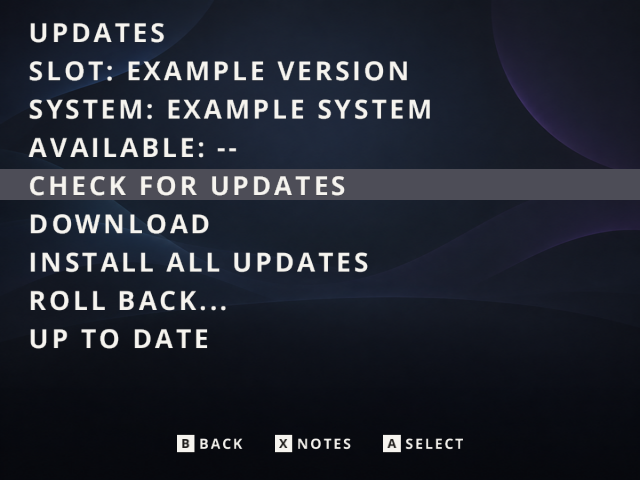

# Small OTA updates



The screen above illustrates the menu with example version data. The production [OTA channel](https://github.com/mriverodorta/slot-rg353v/releases/tag/ota-stable) is live. The exact public installation fetched its catalog over HTTPS, verified the embedded publisher key and accepted sequence 1 as **up to date**. The first catalog is empty; there is no newer package to install yet. Component catch-up, rollback and OS reboot continuation have separate real-device qualification described below.

OTA uses signed, base-specific changes. It does not run Git on the handheld or replace the SD/eMMC disk image. Installation and partition expansion still use the flashable image.

| Component | Download | Activation |
| --- | --- | --- |
| Slot, menus, scripts, artwork | Changed files plus explicit deletions; unchanged files are reused | Restart Slot on the ejected shelf |
| Installed emulation cores | Changed core/source files; state compatibility must be qualified | Restart Slot on the ejected shelf |
| Kernel, device trees, SYSTEM | Copy/literal patch against exact installed boot files | Reboot into the existing OS trial/health mechanism |

The OTA Updates module installs the menu/downloader and its updateable companion managers. Omitting the module omits those companion files. The small factory startup/rollback managers remain OS foundations. Normal boots do not check the internet, scan patches or reconstruct SYSTEM. Ordinary boots retain the offline policy.

## What happens when you update

1. Enable an internet connection and open OTA Updates. A computer can supply internet through USB Networking when internet sharing is configured there.
2. **Check** downloads a small Ed25519-signed catalog. It verifies the publisher, target hardware, validity window and monotonic sequence. The clock must be set correctly.
3. The catalog selects a package matching the exact installed revision, inventory, OS/kernel API and module selection. OS patches also match the actual boot-file checksums. Unsupported bases are not offered an arbitrary patch.
4. **Download** fetches only the selected package, supports resuming interrupted transfers, then verifies its signed size/hash and internal identity. No service is interrupted during download.
5. **Apply** requires an ejected game and sufficient battery/charging. It verifies every supplied byte and builds a separate candidate. It never edits the running revision in place or writes into Games/Saves/States.
6. Slot starts the candidate as a trial. The existing readiness/health checks confirm it or select the previous revision. After confirmation, the session continues with the next compatible patch; an OS reboot returns to this same workflow. A rollback stops further steps.

Settings and installed modules are preserved. Updates cannot silently install an omitted emulator or network feature. A core change needs a tested save-state compatibility declaration; an incompatible migration is rejected rather than guessing how to convert progress.

For Slot/core changes, unchanged revision files share filesystem inodes. Replacements always unlink the candidate's old reference before writing a new file, so rollback bytes and permissions remain intact. This requires the revisions to reside on the same Linux system filesystem, as installed by setup.

Companion managers disable Python bytecode writes, including in the detached systemd worker. Import caches must never appear inside a verified revision. Integrity checking covers the resulting complete revision, not just the downloaded files.

An OS patch reads unchanged compressed data from the selected boot files and adds only the supplied literal ranges. The result must match the full target checksums before it can become bootable. It is mounted read-only for inspection; no second unpacked Linux system tree is needed. The current and previous boot files remain available for rollback, along with temporary staging during installation. A small download does **not** mean rollback needs no local storage.

No OTA package repartitions storage or rewrites the first-stage bootloader. New installations allocate 512 MiB each to boot and Linux storage, with the rest for exFAT content. Older installations keep their existing sizes until backed up and reinstalled. Delta updates still reconstruct and verify payloads locally, and keep compressed rollback data; available-space checks apply before staging. See [installation storage requirements](Installation.md#choose-a-destination).

## Catch up after skipping releases

Choose **Install all updates** after checking and downloading the first update. Confirm once to authorize the compatible sequence. The updater finds the next exact-base patch, installs it, waits for the existing startup health checks, and checks again until it reaches a signed final version. You do not need to install skipped versions manually.

A durable journal on the Linux storage partition records the current step before activation. After a required reboot, Slot returns to OTA rather than auto-launching a cartridge, including with a one-game library. The updater reconciles the previous step's health before downloading anything else. A rollback stops the sequence; it never automatically retries the failed version.

After reboot, the session restores only its previously enabled Wi-Fi/USB network transport. It does not enable Developer Mode, SSH, File Sharing or automatic time. **Waiting for internet…** remains visible during the normal 20–30 second reconnection delay; the connection window is two minutes. If internet is still unavailable, the journal and partial download remain and **Resume updates** retries later. A successful HTTPS catalog/signature exchange establishes readiness; having an IP alone is insufficient.

**Stop updates** asks for confirmation and stops at a safe boundary. It does not kill an installation or interrupt startup confirmation. Once complete or cancelled, the pending startup flag is removed. Subsequent ordinary boots retain the offline policy. The restored connection is a session grant; it does not change persistent network preferences.

The catalog declares final installation identities, module selections and target inventories. An unknown base without a compatible route reports **No supported update path**, not “up to date.” Every supported older version needs a retained exact-base path in the current signed catalog. The client rejects loops and caps a session at 64 steps.

The continuation implementation has host regression coverage and real-device qualification on a private Full TF1 installation. Signed three-step component catch-up, explicit rollback and automatic rollback after a deliberately failing launcher passed. A subsequent real OS delta rebooted into the corrected SYSTEM, waited through eight deliberate feed failures, then continued to a component update automatically. The OS patch downloaded 2,185,324 bytes versus a 72,198,710-byte full capsule. Original feed/downloads were restored, the disposable component was removed, and progress hashes stayed unchanged. The corrected OS was retained on TF1; the older eMMC remained unmounted. The exact public image subsequently passed clean Full SD installation and its factory feed successfully verified the production GitHub catalog; the component/OS trials above used the earlier private test feeds.

## Building and hosting updates

Frontend/core packaging defaults to deltas:

```sh
python3 scripts/rg353v-workflow.py package-update \
  --base-manifest /path/to/qualified/revision.json \
  --component slot --package-id slot-VERSION \
  --output /path/to/release/slot-VERSION-from-BASE.tar.gz
```

The source must first have been built with that exact lock and installed-module composition. `--component cores --states-compatible` additionally requires real state regression testing. `--full-package` produces a legacy full **component** package for a one-time updater bootstrap; it is not a disk image.

Build an OS delta from the matching full capsules retained by the release builder:

```sh
python3 scripts/package-rg353v-os-delta.py \
  --base /path/to/qualified/os-OLD.tar.gz \
  --target /path/to/qualified/os-NEW.tar.gz \
  --output /path/to/release/os-NEW-from-OLD.tar.gz
```

The host uses content-defined chunk boundaries to recover matches even when compressed bytes move. The device executes only bounded copy/data operations; it needs no Git client, binary-patch executable or compiler. The target is still an ordinary verified immutable SYSTEM file.

Sign qualified delta variants in dependency order. In this mixed example, the frontend patch must be built against the new OS factory revision, so it can follow the OS patch:

Signing and the signature regression tests require an OpenSSL build supporting Ed25519 with `pkeyutl -rawin` (OpenSSL 3 or newer). The older development container's OpenSSL 1.1.1 is insufficient for those commands; use a suitable host/CI environment. The qualified handheld runtime uses OpenSSL 3.

```sh
python3 scripts/sign-rg353v-release.py --catalog \
  /path/to/release/os-NEW-from-OLD.tar.gz \
  /path/to/release/slot-VERSION-from-os-NEW.tar.gz \
  --head slot-VERSION \
  --key /secure/publisher-private-key.pem --sequence 42 \
  --notes 'Describe the reviewed changes and restart requirements.'
```

This creates `release.json` and `release.json.sig` beside the archives. Upload the catalog, signature and referenced archives to the dedicated **OTA Updates** release/channel (`ota-stable`), separate from the versioned flash-image release. The factory feed is `https://github.com/mriverodorta/slot-rg353v/releases/download/ota-stable/release.json`. A valid local feed override takes priority over that factory default; an invalid override reports an error instead of silently changing feeds. GitHub's HTTPS redirects to its release-asset host are supported, with a bounded allowlist; arbitrary redirects and HTTP downgrades are rejected. Normal hosts must support byte ranges for interrupted-download resumption.

For the first release, an empty signed catalog can report that the installation is up to date before a patch is available:

```sh
python3 scripts/sign-rg353v-release.py --catalog \
  --output-dir /path/to/release \
  --key /secure/publisher-private-key.pem --sequence 1 \
  --notes 'Initial release; no updates are available.'
```

Publish both catalog files in the dedicated OTA release. Keep the normal image release focused on `.img.gz`, checksums and matching sources. Replace OTA metadata with a newly signed, higher-sequence catalog when an update is available. An empty catalog still requires a valid signature and unexpired metadata.

The publisher private key stays outside the public repository/image. Only trusted public keys belong on the device. Keep the feed sequence increasing and renew signed metadata before its validity expires (maximum 31 days). Never publish the private development feed, provisioning or private test capsules. Every binary update must have immutable matching-source references/materials alongside it as described in [Releasing](Releasing.md).

## Base versions and custom installations

Each delta identifies an exact base. Publish variants for supported starting versions and installed-module combinations, or retain a qualified sequence of intermediate updates in the current catalog. `--head ID` names the final qualified target package; repeat it for distinct final variants. Mixed OS/component catalogs require explicit heads. Component-only catalogs can derive their terminal targets from the package relationships. Corresponding target inventory hashes are produced by the current component packager; repackage older capsules before including them in a catch-up catalog. The signed catalog can hold up to 64 variants within 64 KiB; it selects a compatible target in publisher order and the smallest equivalent artifact. It does not claim to synthesize every custom module combination from one full SYSTEM patch. The release builder must prepare and qualify the variants it advertises. A version without a compatible path needs an explicit migration or fresh installation.

Older devices need the schema-1 updater bootstrap before they can consume schema-2 catalogs. Keep a legacy bootstrap feed/artifact available for those readers; do not simply replace their only feed with an unreadable format. Newly built images contain the new reader and companion managers.

The initial measured r14b→r15 example reduced the archive from 71,561,485 bytes to 1,453,090 bytes, reusing 92,345,623 of 94,172,491 reconstructed bytes. Savings depend on the change and reproducibility of the build; an entirely replaced compressed file may need nearly its full size.

The eMMC qualification also installed the finalized updater as real signed component deltas, exercised the menu's detached systemd job, resumed a real HTTP byte-range download, rejected a corrupted partial file and verified frontend rollback. A subsequent OS update downloaded 5,518,759 bytes instead of the 71,571,677-byte full capsule, rebuilt the target SYSTEM and passed reboot/health confirmation. Kernel and emulator binaries were unchanged in that OS trial. The content comparison confirmed that non-settings files were unchanged. These checks do not qualify every future core/kernel change or every custom installation variant.

The first public image and its factory HTTPS feed are now qualified as recorded in [Releasing](Releasing.md). Future component, core and kernel changes still require their own update/rollback and state compatibility checks.
